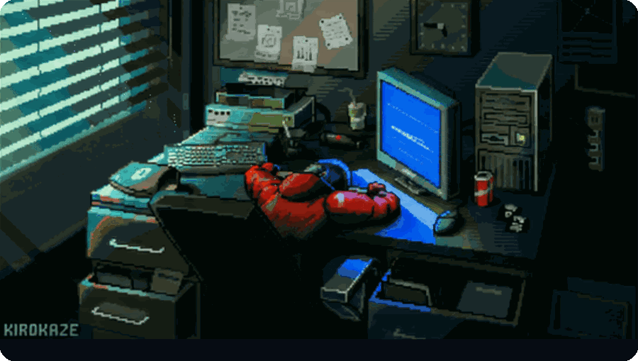
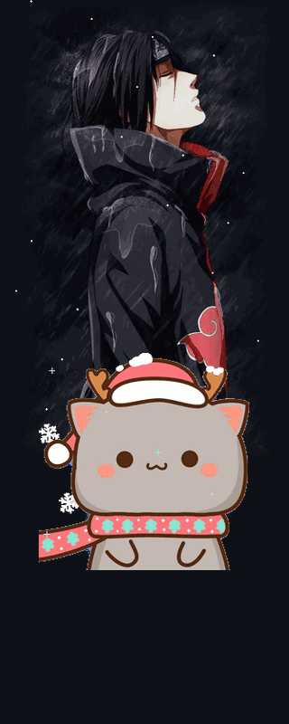

 

 

  

  

---

## 🌙 About Me

Hi, I'm **hfranc827** 👋

I'm a student who enjoys learning, experimenting, and turning ideas into projects. This profile is my little corner to share what I'm building and what I'm learning along the way.

**A few things about this space:**

- 💻 Projects, practice, and experiments
- 🌱 Continuous learning and steady progress
- 🎨 Creative ideas, technology, and a little pixel-art atmosphere
- ☕ Building one step at a time

 

---

## 📊 GitHub Activity

 

<a href="https://github.com/hfranc827">View my GitHub contribution activity</a>

  

The previous GitHub Readme Stats endpoint was returning an error, so this README does not depend on that card. External statistic services can occasionally be unavailable.

---

## 🏆 Milestones

  

---

## 📂 Repositories

Explore my projects, practice, and experiments on GitHub.

  

---

 

❄️ Code · Create · Share · Grow ❄️

 

Thanks for stopping by · <strong>hfranc827</strong> ✨

