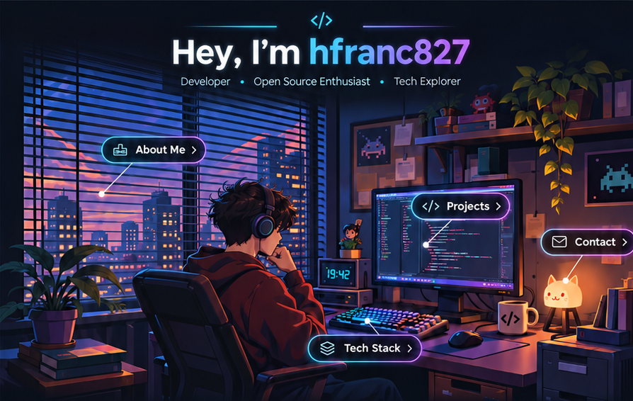

<div align="center">



<p>
  <a href="#about-me"></a>
  <a href="#github-analytics"></a>
  <a href="#tech-stack"></a>
  <a href="#featured-projects"></a>
</p>

### `Developer` · `Student` · `Tech Enthusiast`

</div>

---

## 👨‍💻 About Me

Hi! I'm **hfranc827**, a **[student / developer]** interested in building useful software and exploring new technologies.

- 🎓 **Currently studying:** [Your degree, course, or field]
- 💻 **Main interests:** [Web development, software engineering, data, etc.]
- 🌱 **Currently learning:** [Technology or skill]
- 🔭 **Working on:** [Project or personal goal]
- 🎯 **Goal:** Keep learning and build projects that solve real problems.

```javascript
const developer = {
  username: "hfranc827",
  role: "Student / Developer",
  interests: ["Software Development", "Web", "Technology"],
  currentlyLearning: ["[Technology]"],
  goal: "Build useful things and keep improving"
};
```

---

## 📊 GitHub Analytics

<div align="center">


</div>

## 📈 Contribution Activity

<div align="center">


</div>

---

## ⚡ Tech Stack

<!-- Keep only the technologies you actually use or are actively learning. -->

### Programming Languages

<p>
  
</p>

### Frontend

<p>
  
</p>

### Backend

<p>
  
</p>

### Databases

<p>
  
</p>

### DevOps & Cloud

<p>
  
</p>

### Tools

<p>
  
</p>

---

## 🚀 Featured Projects

<!-- Replace the examples with your real repositories. Delete any row you do not need. -->

| Project | Description | Technologies |
|:--|:--|:--|
| [Project One](https://github.com/hfranc827/PROJECT_ONE) | [What the project does] | [Tech stack] |
| [Project Two](https://github.com/hfranc827/PROJECT_TWO) | [What the project does] | [Tech stack] |
| [Project Three](https://github.com/hfranc827/PROJECT_THREE) | [What the project does] | [Tech stack] |

<div align="center">

[](https://github.com/hfranc827?tab=repositories)

<br />
