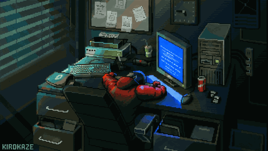

 

 

 

 

  
  
  
  

---

## 🌙 About Me

Hi, I'm **hfranc827**. Welcome to my little corner of GitHub.

✨ Small steps, creative ideas, and continuous learning.

---

## 📊 GitHub Activity

---

## 🏆 Achievements

✨ Every project is a new milestone.

🌟 Learning, creating, and improving one commit at a time.

---

## 📂 Repositories

A collection of projects, practice, and experiments.

 

---

Thanks for stopping by · <b>hfranc827</b> ✨

